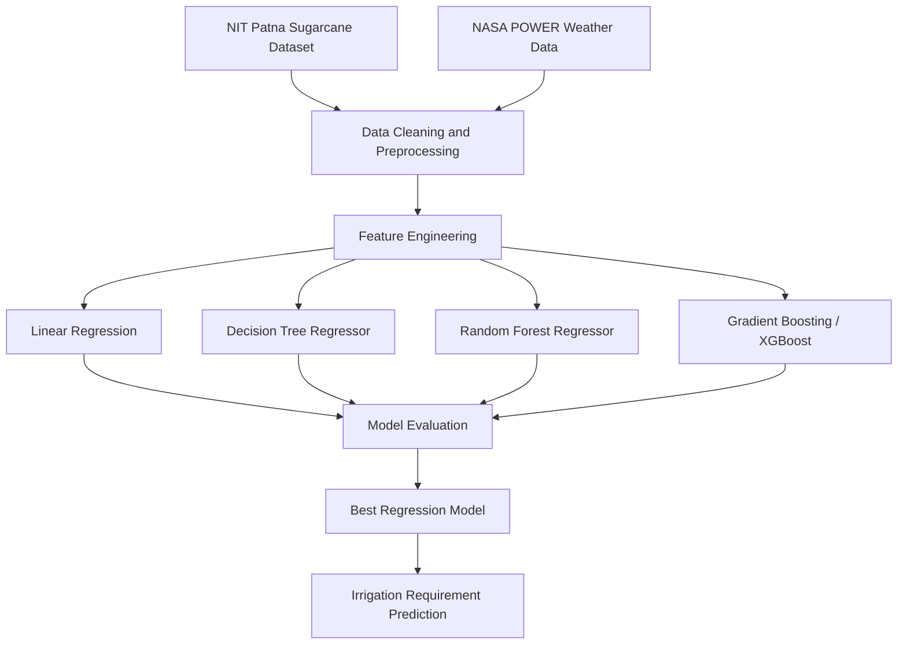
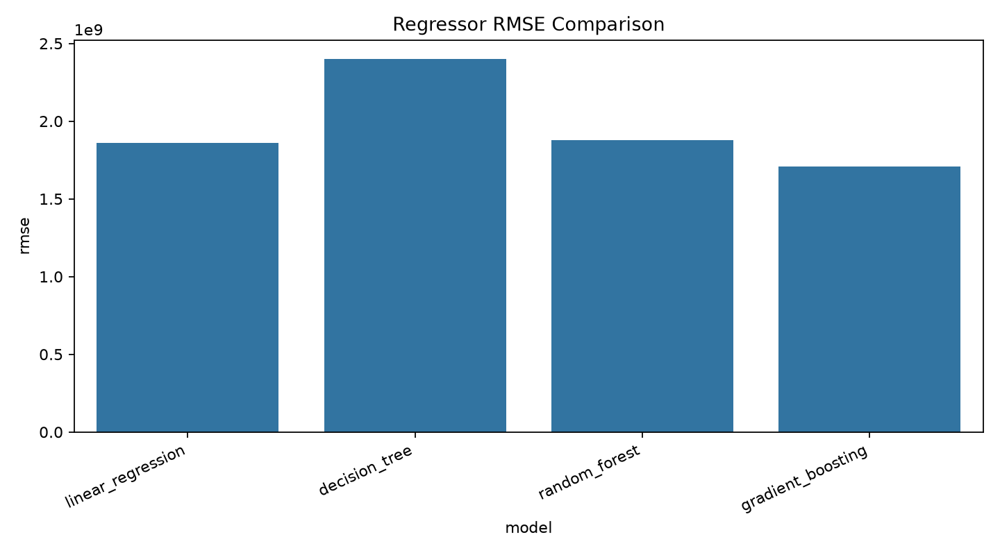
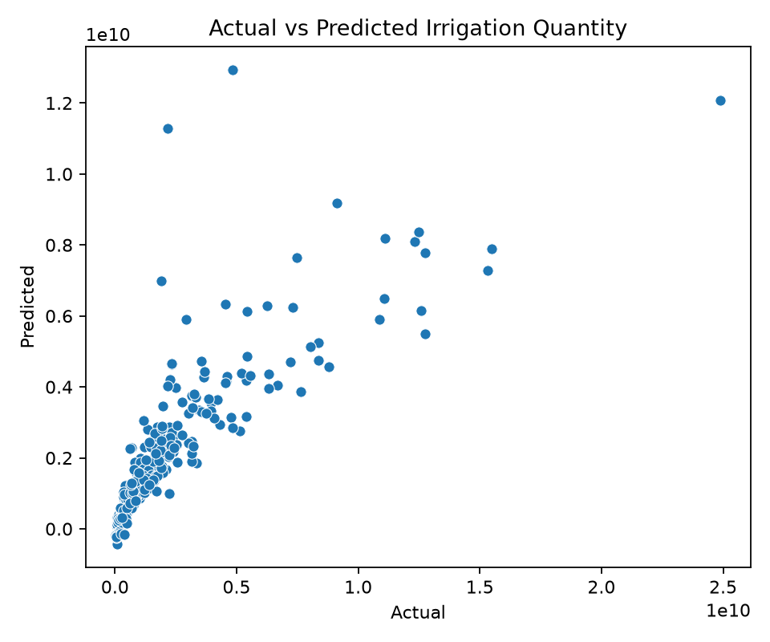
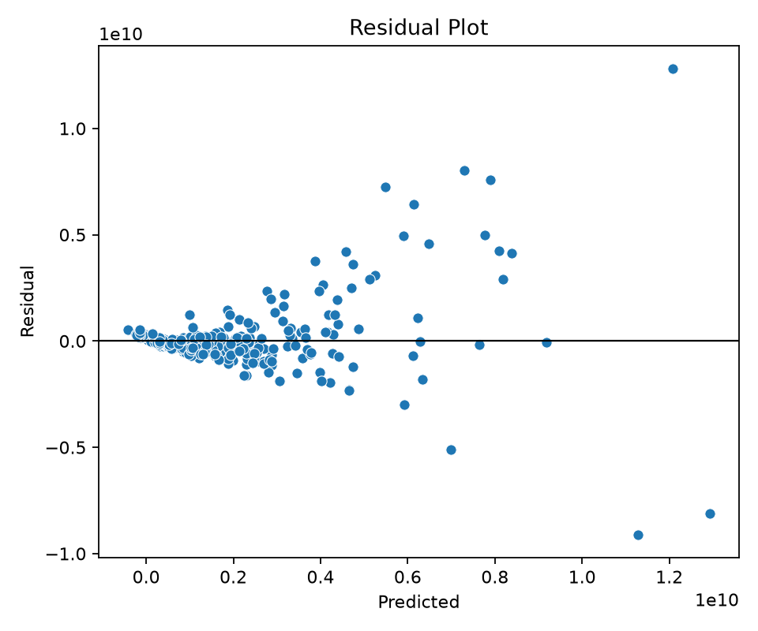
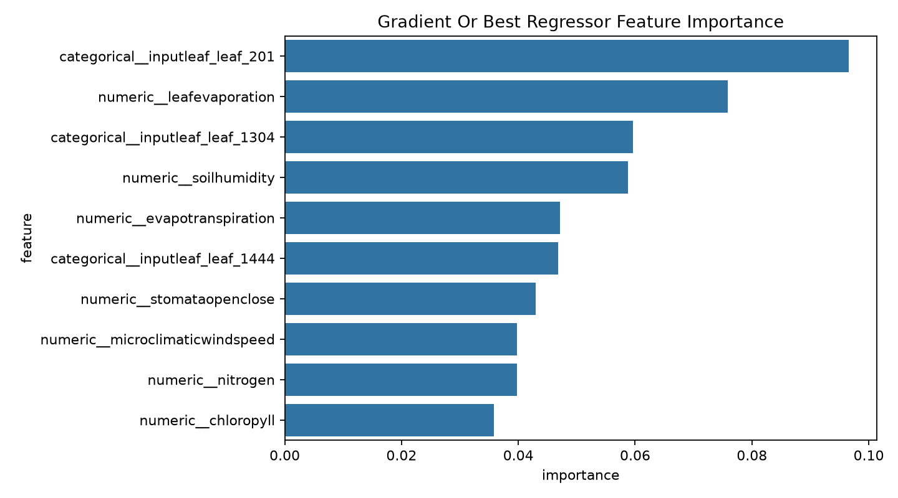

# AI-Based Irrigation Advisory System for Sugarcane

## Overview

This project predicts numerical sugarcane irrigation water requirements from soil, crop, plant, and weather features. It compares four regression algorithms and enriches the agricultural dataset with mandatory NASA POWER agroclimatology data.

The current implementation is intentionally regression-only. Classification was removed because the source dataset provides a numerical irrigation requirement but does not provide a scientifically reliable binary irrigation/no-irrigation label.

## Problem Statement

Over-irrigation wastes water and may damage crops. Under-irrigation can reduce crop health and yield. The objective is to estimate irrigation water requirement from observed soil, crop, plant, and weather conditions so the result can be used as an advisory signal.

## Data Sources

### NIT Patna / SIDSS Sugarcane Dataset

```text
Sugarcane Irrigation Dataset for the SIDSS Framework
Association: NIT Patna
Purpose: Primary soil, crop, plant and irrigation dataset
```

The configured source is the Zenodo record `10.5281/zenodo.19725692`, using `catboostsugarcane_yield_prediction_regularized.csv`. The pipeline downloads only this exact configured dataset and verifies its MD5 hash before training.

Fields present in the dataset include:

- `inputleaf`
- `stomataopenclose`
- `nitrogen`
- `chloropyll`
- `phosphorus`
- `leafhumidity`
- `leafevaporation`
- `evapotranspiration`
- `stages`
- `soilph`
- `soilhumidity`
- `microclimatictemp`
- `microclimaticseason`
- `microclimaticwindspeed`
- `drip_liters_per_day`
- `predicted_water_liters_per_day`
- `yield_kg_per_plant`
- `predicted_yield`

The regression target is `drip_liters_per_day`. Model-generated `predicted_*` fields are excluded from training features to reduce target leakage risk.

### NASA POWER

NASA POWER is mandatory in the intended final pipeline. The implementation uses the daily point API with these variables:

| NASA field | Project feature |
|---|---|
| `T2M` | `temperature_mean` |
| `T2M_MIN` | `temperature_min` |
| `T2M_MAX` | `temperature_max` |
| `RH2M` | `relative_humidity` |
| `PRECTOTCORR` | `rainfall` |
| `WS2M` | `wind_speed` |
| `ALLSKY_SFC_SW_DWN` | `solar_radiation` |
| `PS` | `surface_pressure` |

The SIDSS CSV does not include row-level dates, latitude, or longitude. The default config therefore uses NIT Patna coordinates and a recent complete calendar year for NASA POWER acquisition, then aggregates daily weather across that configured period before merging. This limitation is recorded in `reports/metrics/preprocessing_report.json` after each run.

## Why Regression?

The source data provides a numerical irrigation requirement but does not provide a reliable binary irrigation/no-irrigation label. Therefore, the project uses regression and avoids inventing an arbitrary classification threshold.

## ML Models

1. Linear Regression: interpretable baseline.
2. Decision Tree Regressor: captures nonlinear feature interactions.
3. Random Forest Regressor: ensemble of decision trees for more robust predictions.
4. Gradient Boosting / XGBoost Regressor: sequential boosted trees that improve by fitting previous errors.

The latest run used XGBoost for the gradient boosting implementation.

## Evaluation Metrics

MAE is the average absolute prediction error. RMSE penalizes large errors more heavily. R2 measures how much target variance is explained by the model relative to a baseline.

## Model Results

These results are from the held-out test set generated by the current pipeline after excluding leakage-prone `predicted_*` features.

| Model | MAE | RMSE | R2 |
|---|---:|---:|---:|
| Linear Regression | 1,241,975,701.84 | 1,861,024,286.38 | 0.608 |
| Decision Tree | 1,277,981,402.83 | 2,402,311,810.37 | 0.347 |
| Random Forest | 1,022,519,466.59 | 1,879,236,125.15 | 0.600 |
| Gradient Boosting / XGBoost | 802,871,225.57 | 1,706,409,283.26 | 0.670 |

Best-performing model by RMSE: Gradient Boosting / XGBoost Regressor.

## Architecture



## Project Structure

```text
sugarcane-irrigation-ml/
├── data/
│   ├── raw/
│   ├── external/
│   └── processed/
├── notebooks/
├── src/
│   ├── data/
│   ├── features/
│   ├── models/
│   └── visualization/
├── models/
│   └── regressors/
├── reports/
│   ├── figures/
│   └── metrics/
├── tests/
├── config.yaml
├── requirements.txt
├── .env.example
├── LICENSE
├── README.md
└── main.py
```

## Setup

```bash
git clone <repository-url>
cd sugarcane-irrigation-ml

python -m venv .venv
source .venv/bin/activate
pip install -r requirements.txt
```

On Windows:

```powershell
.venv\Scripts\activate
```

## Running the Project

```bash
python main.py
```

This command acquires the configured SIDSS dataset if needed, fetches or loads NASA POWER weather data, merges datasets, builds features, trains all four regressors, saves model artifacts, writes metrics, and creates plots.

Run tests:

```bash
pytest
```

## Outputs

- Processed features: `data/processed/sugarcane_nasa_features.csv`
- NASA cache: `data/external/nasa_power.csv`
- Trained regressors: `models/regressors/*.joblib`
- Best regressor: `models/regressors/best_regressor.joblib`
- Metrics: `reports/metrics/`
- Figures: `reports/figures/`

Generated data, caches, and model binaries are ignored by git. The code can recreate them.

## Visualizations









## Limitations

- The available SIDSS CSV has no row-level date or coordinate fields, so NASA POWER alignment is approximate.
- The default weather location uses NIT Patna coordinates because the dataset is associated with NIT Patna.
- The dataset has 1,500 rows from a specific source and may not generalize to all sugarcane varieties, regions, soil types, or irrigation practices.
- Sensor and model-derived source fields may contain measurement or modeling noise.
- Predictions are advisory and are not a replacement for agronomic expertise or field validation.

## Future Work

- Add real-time soil sensor ingestion.
- Use field-specific coordinates and observation dates when available.
- Add evapotranspiration-focused weather features.
- Add crop-stage-aware model analysis.
- Deploy the predictor as a web dashboard.
- Validate across multiple farms and geographies.

## Model Notebooks

| Notebook | Role |
|---|---|
| [01_linear_regression.ipynb](notebooks/01_linear_regression.ipynb) | Linear Regression |
| [02_decision_tree_regressor.ipynb](notebooks/02_decision_tree_regressor.ipynb) | Decision Tree Regressor |
| [03_random_forest_regressor.ipynb](notebooks/03_random_forest_regressor.ipynb) | Random Forest Regressor |
| [04_gradient_boosting_regressor.ipynb](notebooks/04_gradient_boosting_regressor.ipynb) | XGBoost Regressor |

See [notebook instructions](notebooks/README.md) for execution and data limitations.

[View/download the complete four-model output report](reports/model_outputs.html) (open the downloaded HTML in a browser for all tables and plots).

[Download the one-page model performance comparison (PDF)](reports/Four_Model_Performance_Comparison.pdf) for the metrics table, comparison charts, and key findings for all four models.
